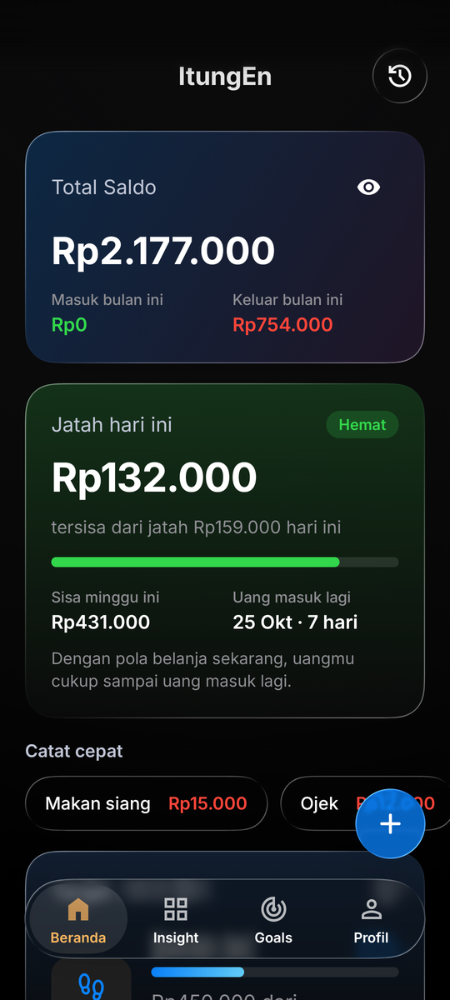
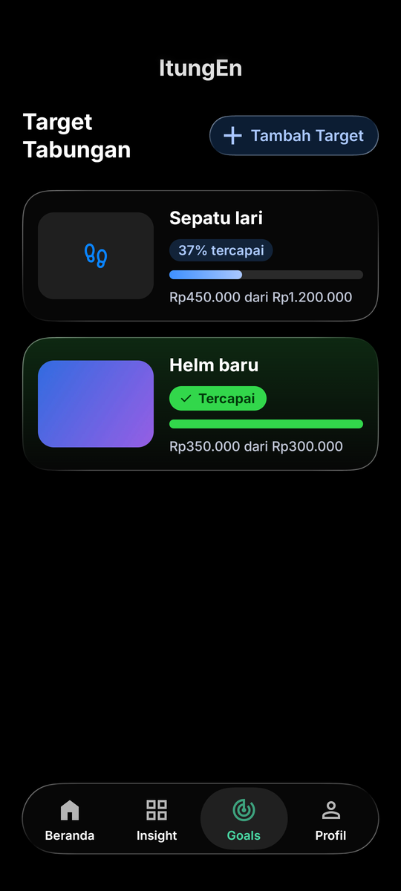
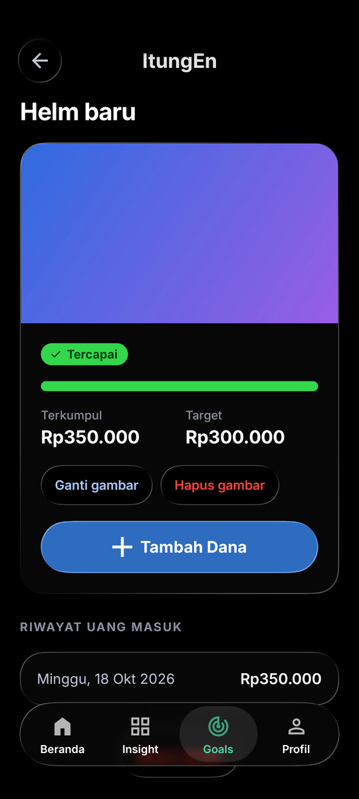
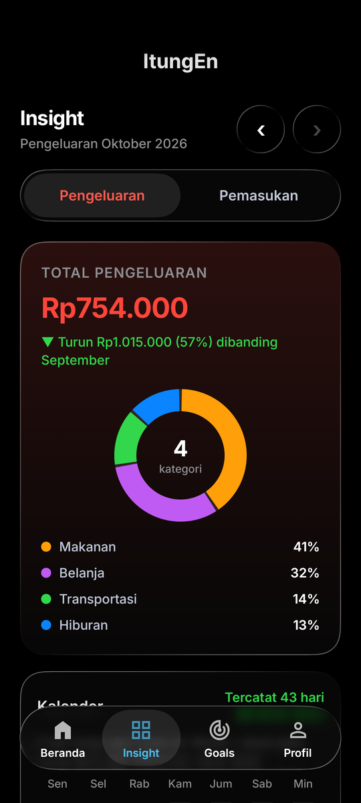
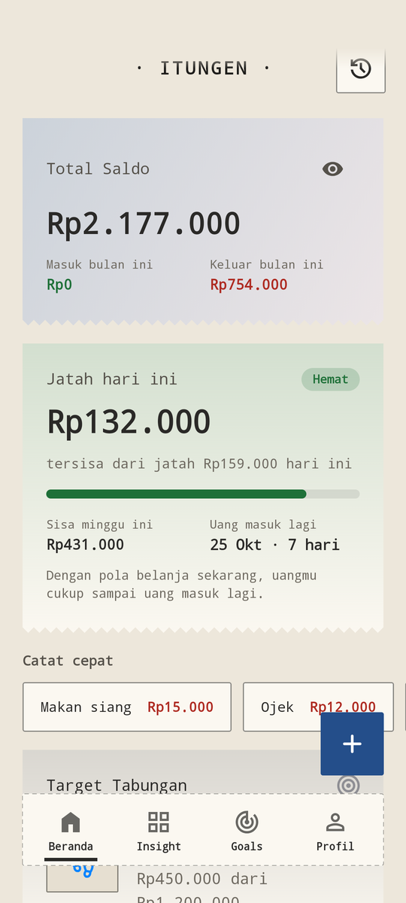
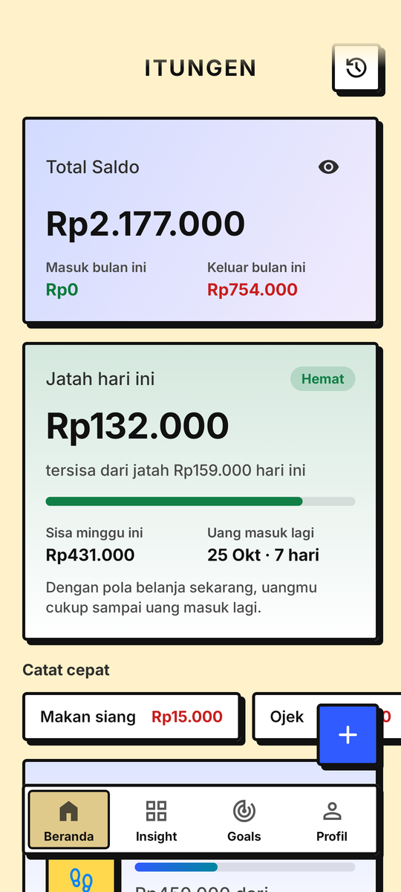
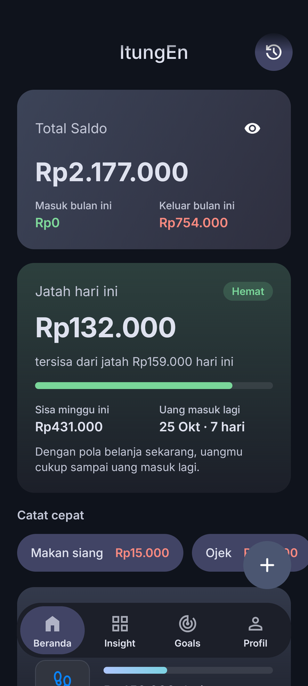
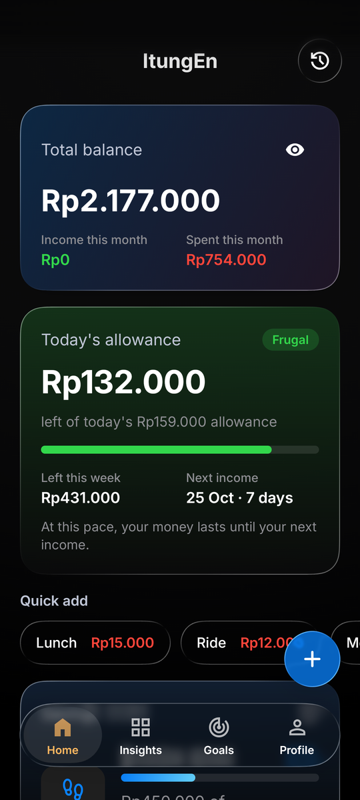

<p align="center">
  
</p>

<h1 align="center">ItungEn</h1>

<p align="center">
  Pencatat keuangan Android yang menghitung <b>berapa yang aman dibelanjakan hari ini</b> dan membantu menabung untuk barang incaran.<br>
  Offline-first · Kotlin + Jetpack Compose · 4 tema · Indonesia / English
</p>

<p align="center">
  
  
  
  
</p>

## Fitur

- **Jatah hari ini.** Beranda menampilkan total saldo dan sisa jatah belanja hari ini serta minggu ini. Jatah dihitung dari pemasukan, tagihan tetap, dan target tabungan, lalu menyesuaikan sendiri setiap kali ada pengeluaran.
- **Catat cepat.** Pengeluaran dan pemasukan bisa dicatat dengan kategori, catatan, dan tanggal lewat keypad kalkulator. Tersedia juga template transaksi yang sering diulang, notifikasi catat cepat (cukup ketik `50rb` langsung dari notifikasi), dan pengingat malam.
- **Target tabungan.**
  - Setiap target punya gambar barang, progres, dan penanda *Tercapai* saat 100%.
  - Halaman detail menampilkan riwayat uang masuk.
  - Saat target dihapus, dananya kembali ke saldo utama.
- **Riwayat.** Pencarian, filter kategori, dan hapus yang bisa diurungkan.
- **Insight.** Diagram pengeluaran per kategori dan per bulan, batas per kategori, kalender pengeluaran, dan streak hari tanpa jajan.
- **Cadangan.** Berkas ZIP berisi data, gambar target, dan riwayat uang masuk, yang bisa dipulihkan di HP mana pun. Tersedia juga ekspor CSV untuk spreadsheet.
- **Sinkronisasi opsional.** Masuk dengan akun Google untuk menyinkronkan antar-HP lewat Firebase. Tanpa akun, semua fitur tetap jalan offline.
- **Ikon adaptif.** Ikon menyesuaikan bentuk ikon launcher (lingkaran, squircle, kotak) dan mendukung *themed icon* Android 13+ lewat lapisan monokrom. Sumbernya ada di `app/src/main/res/drawable/ic_launcher_*.xml`, sedangkan versi PNG 512×512 ada di `docs/icon-512.png`.

### Tema

Empat tema, masing-masing dengan mode gelap dan terang. Tema bisa diganti kapan saja di **Pengaturan → Tampilan**. Di semua tema, navbar melayang bisa ditahan lalu digeser untuk berpindah tab.

| Tema | Ciri |
|---|---|
| **Liquid Glass** | Kaca bening ala iOS 26 yang membiaskan isi layar |
| **Struk** | Gaya kertas struk kasir: monospace dan garis putus-putus |
| **Neo-brutalism** | Garis tebal, bayangan keras, dan warna berani |
| **Material You** | Mengikuti warna wallpaper (dynamic color) Android |

<p align="center">
  
  
  
  
</p>

### Bahasa

Pilihan bahasa ada di **Pengaturan → Bahasa**:

- **Ikuti sistem** (bawaan): bahasa Indonesia atau English, sesuai bahasa HP. Bila bahasa HP bukan keduanya, app memakai bahasa Indonesia.
- **Bahasa Indonesia** atau **English**: bisa juga diatur lewat setelan bahasa per-aplikasi Android.

Format nominal tetap Rupiah (`Rp1.250.000`) di kedua bahasa, sedangkan format tanggal mengikuti bahasa yang dipilih. Nama kategori, catatan, dan target yang kamu buat sendiri tidak diterjemahkan.

## Pasang dari Releases

1. Buka [Releases](https://github.com/Liezert/ItungEn/releases), lalu unduh `ItungEn-v1.0.0.apk`.
2. (Opsional) Cocokkan SHA-256-nya dengan berkas `.sha256` di rilis yang sama. Di PowerShell: `Get-FileHash ItungEn-v1.0.0.apk`.
3. Pasang APK-nya. Android mungkin meminta izin "pasang dari sumber ini".

Syarat: **Android 13 (API 33) atau lebih baru.**

> [!WARNING]
> **Sudah memasang versi uji/debug ItungEn sebelumnya?** APK rilis ditandatangani dengan kunci yang berbeda, jadi Android menolak memperbaruinya di atas versi lama. Lakukan urutan berikut:
> 1. Di versi lama, buka **Pengaturan → Data → Ekspor cadangan (ZIP)** dan simpan berkasnya di tempat aman (mis. Google Drive).
> 2. Copot (uninstall) versi lama. Langkah ini **menghapus data di HP**, jadi pastikan cadangannya sudah ada.
> 3. Pasang APK rilis, lalu buka **Pengaturan → Data → Pulihkan dari cadangan**. Data, gambar target, dan riwayat uang masuk akan kembali.

## Build dari source

Yang dibutuhkan:

- Android Studio versi terbaru (AGP 9.2, JDK bawaan Android Studio).
- Android SDK 36.1 (`compileSdk` 36.1, `targetSdk` 36).
- HP atau emulator dengan Android 13 ke atas (`minSdk` 33).

```bash
git clone https://github.com/Liezert/ItungEn.git
cd ItungEn
./gradlew assembleDebug        # Windows: gradlew.bat assembleDebug
./gradlew testDebugUnitTest    # unit test
./gradlew lintDebug            # lint (terjemahan yang hilang = error)
```

APK debug ada di `app/build/outputs/apk/debug/`.

**Firebase.** Berkas `app/google-services.json` berisi konfigurasi klien Firebase milik proyek ini. Untuk memakai Firebase sendiri, ganti berkas ini dengan milikmu dan daftarkan SHA-1 kunci penanda tanganmu di Firebase Console agar masuk Google berfungsi. Bila berkas ini dihapus, app tetap ter-build dan berjalan dalam mode tamu.

**Build rilis bertanda tangan.**

1. Buat `keystore.properties` di akar proyek. Berkas ini sudah ada di `.gitignore`, jadi **jangan di-commit**.

   ```properties
   storeFile=C:/path/ke/kunci-rilis.jks
   storePassword=...
   keyAlias=...
   keyPassword=...
   ```

   Sebagai gantinya, kamu juga bisa memakai variabel lingkungan `ITUNGEN_KEYSTORE`, `ITUNGEN_KEYSTORE_PASSWORD`, `ITUNGEN_KEY_ALIAS`, dan `ITUNGEN_KEY_PASSWORD`.

2. Jalankan build rilis:

   ```bash
   ./gradlew assembleRelease
   ```

Build rilis memakai R8 (minify + shrink resources). Tanpa kunci, `assembleRelease` tetap jalan, tetapi APK-nya tidak ditandatangani.

### Struktur singkat

| Modul / paket | Isi |
|---|---|
| `app/.../data` | Room (database lokal), repository, cadangan ZIP/CSV, sinkronisasi Firestore |
| `app/.../domain` | Model dan perhitungan jatah/target (tanpa Android, diuji dengan unit test) |
| `app/.../ui` | Layar Compose; `ui/design` berisi abstraksi tema (`ThemeSpec`) dan keempat temanya |
| `app/.../work` | Pengingat harian (WorkManager) dan notifikasi catat cepat |
| `glass/` | Komponen Liquid Glass (navbar, tombol, sheet, dialog) di atas library Backdrop |

Dokumen lain: [PRD](PRD.md), [spesifikasi desain](DESIGN_SPEC.md), dan [catatan performa](docs/PERFORMANCE.md).
